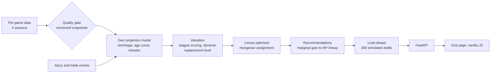

# Design notes

A fantasy basketball draft assistant. You make the pick on ESPN or Yahoo yourself; the app tells you who is worth taking and why. It never drafts
for you. Nothing about the league is hard-coded: sport, scoring format, number of teams, draft slot and roster are inputs.

## The problem

At each pick a drafter has to answer three questions: how good is each player for *my league's* scoring, how much does he add to *my roster as it
stands*, and will he still be there at my next turn if I wait. A static ranking answers the first at best. The app answers all three, and
re-answers them after every pick.

## How it works

* **Valuation.** Points leagues sum the league's weights over projected stats; category leagues use z-scores. Each player's value is measured
  *over replacement*, and the replacement level is recomputed from whoever is left after every pick, so scarcity shows up as the draft thins.
* **Roster fit.** Slots such as G, F and UTIL accept several positions, so "best lineup from these players" is an assignment problem. It is solved
  exactly with the Hungarian algorithm (SciPy). A pick is scored by how much it raises the best lineup, not by his rank.
* **Timing.** The look-ahead simulates the other drafters 300 times (a shared ranking plus noise that grows with rank), and reports how often each
  candidate is still available at your next turn. Odds are shown as odds, not as certainty.
* **Own projections.** Shrinkage on per-minute rates, projected minutes and games, an age curve, and a hand-edited
  overrides file for what a model cannot know (rookies, role changes). The three most recent seasons are used on purpose: older seasons describe a
  different player.
* **Data pipeline.** Tables pass a quality gate before they are stored as immutable, rollback-able snapshots. Late news (injuries, trades) arrives as
  small idempotent events ordered by timestamp, so a late older event cannot overwrite newer news. See `docs/PIPELINE.md`.

## Decisions and trade-offs

| Decision | Why | What it costs |
|---|---|---|
| Poll every 5 seconds, no WebSockets | The platforms offer no push, picks arrive every 30 to 90 seconds, and a push channel would only relay what the server just polled | Up to 5 seconds of delay. If shared rooms were ever needed: a socket per room, state under the existing lock, Redis pub/sub once there is more than one worker |
| One lock per draft, in process | Picks, undo, reset and sync must never interleave; verified with real-thread tests that fail without it | It does not span processes: several workers would need a shared store |
| Idempotency key on every pick | A double click or a retry must not draft a player twice | Keys are remembered for a bounded time (500 per draft) |
| In-memory private sessions when hosted | A public demo must not mix visitors' drafts or write to disk | Drafts vanish on restart; free hosting also sleeps when idle |
| SQLite for the pipeline | No server to run, transactional, standard library | One writer; not a multi-node design |
| Recompute on every request | A pure function of data plus the pick log can never go stale | Recommendations are CPU-bound (see Limits) |
| Standard-library metrics and logs | No dependency for a few counters; Prometheus text is understood by every scraper | Per process, in memory, percentiles from recent requests only |

## How it is checked

* Automated tests, run in CI on Python 3.12 and 3.13 with the newest packages. Concurrency tests drive real threads and were confirmed to fail when
  the lock is removed. Analysis code was checked by planting bugs and confirming a test fails; that exercise found tests that were too weak and
  led to the exact-value tests now in place.
* Out-of-sample backtests: 36 simulated 12-team drafts of the 2025-26 season using only earlier data, scored on that season's real stats.
* Calibration: `app/calibration.py` fits the look-ahead's opponent model to real draft logs and checks "X% likely to last" against what happened.
  On drafts simulated from a known noise model it recovers the truth.

## Results

All with one season of real stats, simulated opponents, and a player pool taken from the model's own top 200 (which favours the model).

* The app's lineup beat an autodraft-style baseline (best player left by last season's production) by **4,684 season points** (95% CI 3,831 to
  5,525), ahead in 97% of paired drafts, with a mean finish of 1.5th against 6.5th of 12.
* The projections account for almost all of it (+4,604). The roster-aware recommendation logic added **+80** (CI -347 to +534): not
  distinguishable from zero. The value so far comes from the projections.
* The gap comes from volume and role: the app's starters played 3.2 more minutes per game and scored 7.6 more fantasy points per game, with equal
  games played, so it is not injury luck. Efficiency and turnovers were slightly worse.
* Projected risers did rise: correlation +0.39 (CI +0.28 to +0.48) between projected and real change, out of sample; the model understates young
  players' growth.
* First look at calibration, one mock draft and in-sample: other drafters were noisier than the look-ahead assumes, so its "unlikely to last"
  calls were too pessimistic. Being followed up with more drafts before any constant is changed.

## Limits

* Recommendations take about 1.7 s at the median with four simulated users on one test machine (`research/load_test.py`), so they are the
  bottleneck under concurrency. Run the load test against your own deployment before quoting a latency.
* The age curve is fitted on one season transition; the backtest covers one season and 143 players.
* The opponent model ignores positional need and team strategy.
* Live ESPN and Yahoo sync have never run against a real league. Manual entry is the tested path.
* Hosting is a free tier: it sleeps when idle, forgets drafts on restart, and uses sample data only.

## What I would do next

Calibrate the opponent model on real league drafts (the export command is built), add a positional-need term and test whether the look-ahead then
beats the plain ranking, cache recommendations per draft state, and run the live sync against a real draft.
