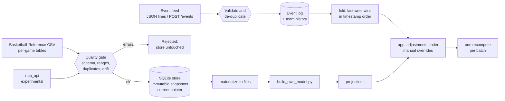

# Data pipeline

The pipeline keeps the app's inputs honest. Data comes in through a quality gate, is stored as immutable versions that can be rolled back,
and late-breaking facts (injury news, trades) arrive as small idempotent events that the app folds into its projections with one recompute
per batch. It is plain Python plus SQLite from the standard library, so every part of it is testable without a network.



## Parts

| Module | What it does |
|---|---|
| `pipeline/sources.py` | One small interface per source. `BRPerGameCsv` is the path the project uses. `NbaApiSource` is **experimental** (see limits). |
| `pipeline/quality.py` | The gate before anything is stored. Schema drift, impossible values, duplicates and non-numbers are errors; new columns and large row-count swings are warnings. |
| `pipeline/store.py` | SQLite: events (unique by `event_id`), snapshots with a movable "current" pointer, effective-dated team history, id crosswalk. One connection behind a lock. |
| `pipeline/ingest.py` | Source, gate, then store. Identical content to the current snapshot is not stored again. `materialize` writes the current snapshots back to files. |
| `pipeline/events.py` | Strict event validation with actionable messages, and `fold`, a pure function from an event log to per-player adjustments. |
| `pipeline/replay.py` | Replays a recorded feed against the running app in bursts. |
| `pipeline/__main__.py` | The `python -m pipeline` commands. |

## Guarantees, and the tests that check them

| Guarantee | Test file |
|---|---|
| A bad table (missing column, out-of-range value, duplicates) is refused with a message that names the problem | `tests/test_pipeline_quality.py` |
| A rejected or unreadable table leaves the store exactly as it was; the same file twice stores one snapshot | `tests/test_pipeline_ingest.py` |
| Rollback plus `materialize` restores the old file byte for byte, accents included | `tests/test_pipeline_ingest.py`, `tests/test_pipeline_replay_cli.py` |
| An event sent many times (including from 20 threads at once) is stored once | `tests/test_pipeline_store.py`, `tests/test_pipeline_api.py` |
| A late event with an older timestamp cannot overwrite newer news | `tests/test_pipeline_events.py`, `tests/test_pipeline_api.py` |
| A batch of N events is one recompute; a retried batch is zero | `tests/test_pipeline_api.py`, `tests/test_pipeline_replay_cli.py` |
| Your manual what-if override always beats a feed event | `tests/test_pipeline_api.py` |
| A trade is a new dated fact, not an overwrite, so "which team on date X" has an answer | `tests/test_pipeline_store.py`, `tests/test_pipeline_api.py` |
| Hosted sessions are private and write no database file | `tests/test_pipeline_api.py` |

## Using it

```
python -m pipeline ingest                  # store data/nba/raw/per_game_<year>.csv as versioned snapshots
python -m pipeline snapshots               # list them; * marks the current one
python -m pipeline rollback per_game_2026 1
python -m pipeline materialize             # write current snapshots back to data/nba/raw, then: python build_own_model.py
python -m pipeline replay pipeline/examples/injury_news.jsonl     # with the server running
python -m pipeline events | team "Jayson Tatum"
```

The example feed is **invented** to show the mechanics. Event endpoints: `POST /events`, `GET /events`, `GET /events/effective`,
`DELETE /events`, `GET /pipeline/snapshots`, `GET /pipeline/team-history?player=...&on=...`.

## Limits (read these before claiming anything)

- Nothing here has run against a live data feed. `NbaApiSource` was tested only against a hand-made sample of the documented response shape,
  and the live service blocks many cloud networks.
- There is no scheduler. Ingest and replay run when you run them.
- `build_own_model.py` still reads files, so a rollback takes effect only after `materialize` and a rebuild.
- Event ordering is by timestamp then arrival; clocks are the sender's. Two senders with skewed clocks can still disagree.
- One process, one SQLite file. The store is thread-safe; several server workers would each need the same file or a shared database.
- Event endpoints are basketball-only.
- A non-object item in a batch is refused by the request validator, which rejects the whole batch (HTTP 422) instead of that item alone.

## What testing found

While writing the integration tests, the previous-snapshot warnings (changed columns, a row count that moved more than 25%) turned out to
never fire in a real ingest: the ingest step handed the checker the snapshot record, but the checker reads the quality report stored inside it.
The checker's own unit tests passed the right shape directly, so only the ingest-level tests caught it. Fixed, with two regression tests
that fail when the fix is removed.
